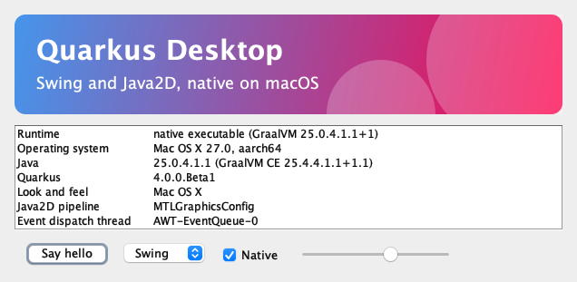

# Quarkus Desktop on macOS

A small Swing application that shows a [Quarkus Desktop](https://github.com/quarkiverse/quarkus-desktop) application
running as a **native executable on macOS**, built with Quarkus 4.0.0.Beta1 (the first Quarkus whose `quarkus-awt`
supports macOS) and GraalVM 25.1 or later.



The window shows where it runs: the runtime (native executable or JVM), macOS, the Quarkus version, the Aqua look and
feel and the Metal Java2D pipeline. It has a banner painted with Java2D, a few Swing components, and the About item of
the macOS application menu opens a dialog through a CDI event.

## Requirements

- A Mac with Apple silicon.
- GraalVM for JDK 25, release 25.1 or later (for example
  [GraalVM Community 25.4](https://github.com/graalvm/graalvm-ce-builds/releases)), with `GRAALVM_HOME` set to its
  `Contents/Home`. GraalVM 25.0.x does not support AWT on macOS.
- The Xcode Command Line Tools (`xcode-select --install`).

## Run

In JVM mode:

```bash
./mvnw quarkus:dev
```

As a native executable:

```bash
./mvnw package -Dnative
./target/quarkus-desktop-macos-demo-1.0.0-SNAPSHOT-runner
```

The build output directory contains the executable and the JDK libraries it loads (`libawt.dylib`, `libosxapp.dylib`,
`libosxui.dylib`...): keep them together when you copy the application.

To check the application without a click, `demo.snapshot` saves an image of the window to a file, then closes it:

```bash
./target/quarkus-desktop-macos-demo-1.0.0-SNAPSHOT-runner -Ddemo.snapshot=native.png
```

## The code

- `DemoWindow`: the window, a `@Singleton` CDI bean opened by an observer of `DesktopStartupEvent` (on the event
  dispatch thread). No `@QuarkusMain`: closing the window stops the application.
- `Banner`: Java2D painting (a gradient, shapes with transparency, antialiased text).
- `ApplicationMenu`: the About item of the macOS application menu (`AboutEvent`) and Cmd-Q (`QuitRequest`) as CDI
  events.
- `application.properties`: the system look and feel (Aqua), and an information property list in the executable (the
  application name in the menu bar and the Dock).
